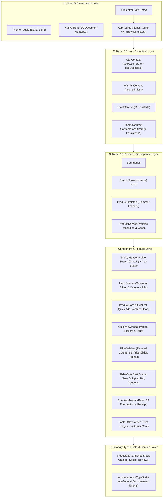
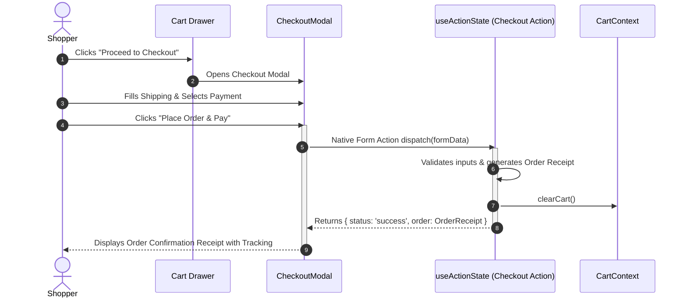
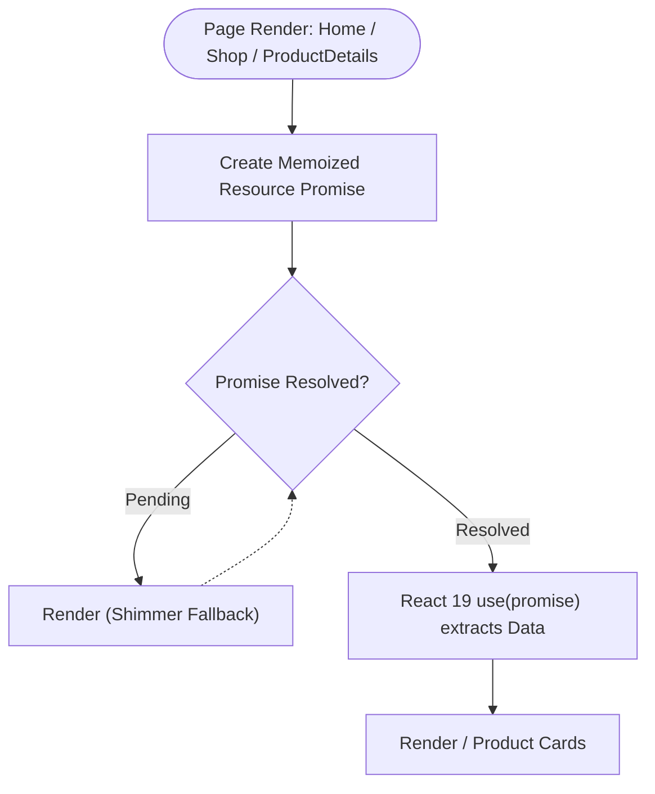
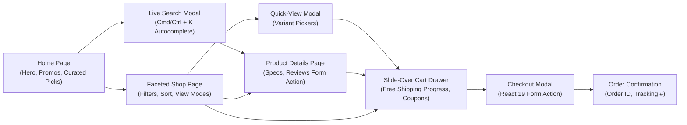

# ⚡ EazyKart - React 19 Modern E-Commerce Platform

A production-grade, highly-responsive, modern e-commerce marketplace built on **React 19, TypeScript Strict Mode, Vite 6, and Tailwind CSS v3.4**.

Featuring native **React 19 primitives** (`useActionState`, `useOptimistic`, `use(promise)`, `<Suspense>`, direct `ref` props, native document metadata), dark/light theme styling, faceted filtering, slide-over cart drawer with free-shipping metrics, and instantaneous checkout.

---

## 📐 System Architecture



---

## 🔄 Core Flow Diagrams

### 1. React 19 Optimistic Cart Flow

```mermaid
sequenceDiagram
  autonumber
  actor User as Shopper
  participant UI as ProductCard / QuickView
  participant Opt as useOptimistic (Cart State)
  participant Action as useActionState (cartReducer)
  participant Storage as LocalStorage

  User->>UI: Clicks "Add to Cart" / Adjusts Quantity (+/-)
  activate UI
  UI->>Opt: startTransition -> setOptimisticCart(action)
  activate Opt
  Note over Opt: UI updates IMMEDIATELY (0ms lag)
  Opt-->>User: Visual feedback, badge bounce & toast notification
  deactivate Opt

  UI->>Action: dispatchCartAction(action)
  activate Action
  Action->>Action: Pure synchronous cartReducer calculation
  Action->>Storage: Persist { items, discountCode }
  Action-->>Opt: Synchronize confirmed state
  deactivate Action
  deactivate UI
```

---

### 2. Form Action & Instant Checkout Flow



---

### 3. React 19 `<Suspense>` & `use(promise)` Resource Fetching



---

### 4. Shopper Navigation & User Journey Flow



---

## 🛠️ Technology Stack

| Category | Technology | Description |
| :--- | :--- | :--- |
| **Framework** | React 19 (`react@^19.0.0`) | Native `useActionState`, `useOptimistic`, `use(promise)`, `<Suspense>`, Direct `ref` props, Native Metadata |
| **Language** | TypeScript 5.7+ | Strict typing, `noUnusedLocals: true`, `noUnusedParameters: true` |
| **Bundler** | Vite 6 | Lightning-fast HMR and optimized production chunking |
| **Styling** | Tailwind CSS v3.4 + PostCSS | Dark mode (`class` strategy), glassmorphism, responsive utilities |
| **Icons** | Lucide React | Modern, lightweight SVG iconography |
| **Routing** | React Router v7 | Seamless client-side routing and smooth scroll resets |

---

## 🚀 Getting Started

### Prerequisites
- Node.js `v18.0.0` or higher
- npm `v9.0.0` or higher

### Installation & Run

```bash
# 1. Clone or navigate to the project directory
cd EazyKart

# 2. Install dependencies
npm install

# 3. Start development server
npm run dev
# Server ready at http://localhost:3000

# 4. Run TypeScript strict typecheck
npm run typecheck

# 5. Build for production
npm run build
```

---

## 🏷️ Test Coupons
- `SAVE20`: 20% OFF Site-Wide Spring Discount
- `EAZY10`: 10% OFF Welcome Bonus
- `FLASH30`: 30% OFF Flash Sale Special

---

## 📄 License
Licensed under the [MIT License](LICENSE).