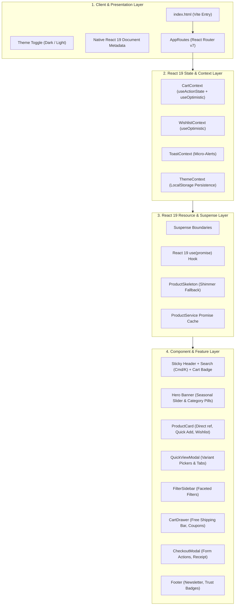
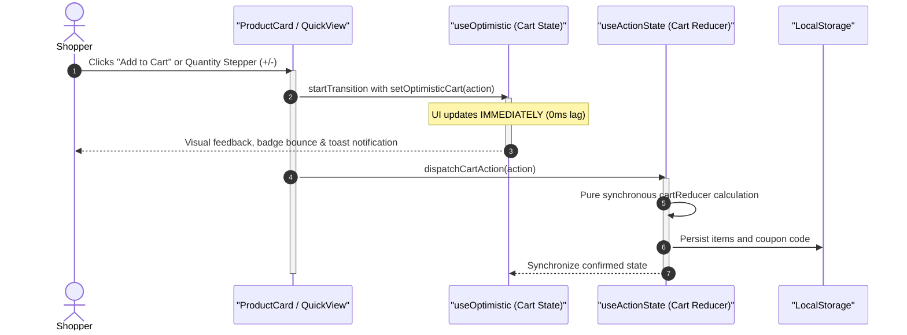

# 📖 Walkthrough: EazyKart - React 19 Modern E-Commerce Platform

A production-grade, highly-responsive modern e-commerce marketplace built on **React 19, TypeScript Strict Mode, Vite 6, and Tailwind CSS v3.4**.

---

## 💡 React 19 Architectural Highlights



---

## 🔄 Core Optimistic Cart Flow



---

## 🧪 Verification & Feature Validation

| Feature | Primitive / Technique | Verification Result |
| :--- | :--- | :--- |
| **Instant Cart Feedback** | `useOptimistic` + `startTransition` | Immediate quantity adjustment with 0ms visual lag |
| **Form Processing** | `useActionState` | Native form submission, error handling, receipt generator |
| **Data Fetching** | `use(promise)` + `<Suspense>` | Shimmer skeleton screens during initial catalog hydrate |
| **Faceted Filtering** | Custom Filter Engine | Instant filtering across Category, Price, Rating, and Stock |

---

## 🚀 How to Run

```powershell
cd "C:\Users\Admin\.gemini\antigravity-ide\scratch\New folder\EazyKart"

# Install dependencies if needed
npm install

# Start Vite dev server
npm run dev
```

Open your browser at **[http://localhost:5173](http://localhost:5173)**.
